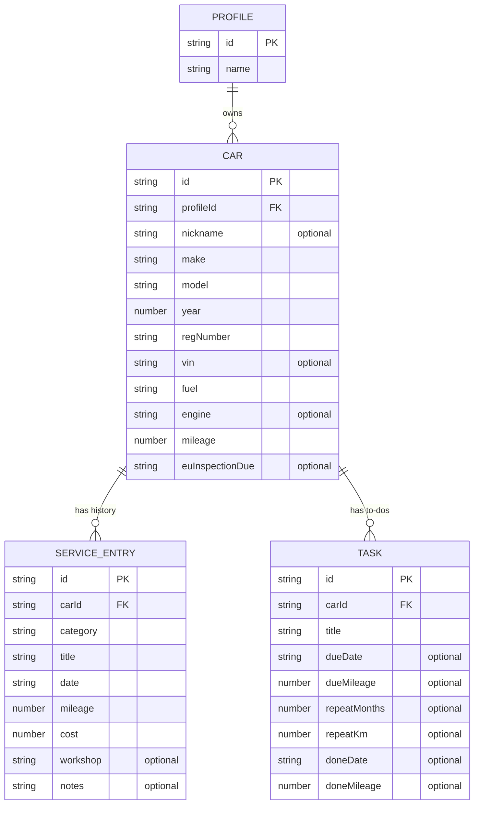

# Data model

The shape of `src/model/model.js`: what MotorCatalog stores, what is only screen state, and what is worked out on the fly. We designed it from the mockups in [`mockups/`](mockups/) and the feature list in the README.

Status: approved 15.10.2026. The code follows it.

## The MVC rule

`model.js` exports one plain object and nothing else. No functions, no classes, no DOM.

```js
export const model = {
  app: { ... },    // what is on screen right now
  inputs: { ... }, // what is typed into the open form
  data: { ... },   // what is saved to localStorage
}
```

- The **controller** is the only code that changes `model`. After a change it saves `model.data` if needed and calls its `render()`, which hands `model` and `derived` to the view. `derived` holds the values worked out from the model (see [Derived values](#derived-values)).
- The **view** reads `model` and renders HTML. It never changes `model`.
- Anything that can be worked out from stored data is **not** stored. The controller computes it when it is needed (see [Derived values](#derived-values)).
- Fixed project setup, such as the currencies on offer, lives in `src/config.js`. It is not state.

## Entities



### Profile

A local profile that keeps one person's cars apart from another's on a shared device. It is not a login.

| Field | Type | Rules |
|---|---|---|
| `id` | string | From `crypto.randomUUID()` |
| `name` | string | Required, trimmed, at most 40 characters |

### Car

| Field | Type | Rules |
|---|---|---|
| `id` | string | From `crypto.randomUUID()` |
| `profileId` | string | The profile that owns the car |
| `nickname` | string or null | Optional, trimmed, at most 40 characters. When it is set it is the car's title, with make and model under it |
| `make` | string | Required, e.g. "Volvo" |
| `model` | string | Required, e.g. "V70" |
| `year` | number | 1900 to next year |
| `regNumber` | string | Required. Saved in capitals without spaces ("ab 12345" becomes "AB12345") |
| `vin` | string or null | Optional. 17 characters, saved in capitals, letters and digits only, never I, O or Q. Shown beside the registration number when it is set |
| `fuel` | string | One of `petrol`, `diesel`, `electric`, `hybrid`, `other` |
| `engine` | string or null | Optional free text, e.g. "2.0 D4" |
| `mileage` | number | Whole km from 0. See [Mileage](#mileage) |
| `euInspectionDue` | string or null | Date of the next EU inspection (EU-kontroll) |

### Service entry

One line in the service history. Services, repairs and other costs share one list, told apart by `category`. The costs page sums `cost` per category and year from this list.

| Field | Type | Rules |
|---|---|---|
| `id` | string | From `crypto.randomUUID()` |
| `carId` | string | The car it belongs to |
| `category` | string | One of `service`, `repair`, `other` |
| `title` | string | Required. The type of work, e.g. "Oil change" |
| `date` | string | Required date, not in the future |
| `mileage` | number | Whole km from 0 |
| `cost` | number | Whole NOK from 0 |
| `workshop` | string or null | Optional |
| `notes` | string or null | Optional |

### Task

A maintenance to-do or reminder, like "Change to winter tyres" or "Timing belt". A task can be due by date, by mileage, both or neither. It can also repeat.

| Field | Type | Rules |
|---|---|---|
| `id` | string | From `crypto.randomUUID()` |
| `carId` | string | The car it belongs to |
| `title` | string | Required |
| `dueDate` | string or null | Optional deadline |
| `dueMileage` | number or null | Optional deadline in km |
| `repeatMonths` | number or null | Optional. Repeat this many months after it is done |
| `repeatKm` | number or null | Optional. Repeat this many km after it is done |
| `doneDate` | string or null | `null` while the task is open |
| `doneMileage` | number or null | The car's km when it was done |

## The whole object

```js
export const model = {
  app: {
    page: "garage", // garage | carForm | car | history | maintenance | costs | profiles
    selectedCarId: null,
    historyFilter: "all", // all | service | repair | other
    costsYear: null, // null = the current year
    preferences: {
      chosen: { lang: null, theme: null, currency: null }, // null = follow the system
      system: { lang: "en", theme: "dark", currency: "NOK" },
    },
  },
  inputs: {
    profile: { name: "" },
    car: {
      nickname: "", make: "", model: "", year: "", regNumber: "", vin: "",
      fuel: "petrol", engine: "", mileage: "", euInspectionDue: "",
    },
    serviceEntry: {
      category: "service", title: "", date: "", mileage: "",
      cost: "", workshop: "", notes: "",
    },
    task: {
      title: "", dueDate: "", dueMileage: "", repeatMonths: "", repeatKm: "",
    },
    editingId: null, // the id being edited, or null when adding
    errors: {}, // field name to error text key
  },
  data: {
    version: 1,
    activeProfileId: null,
    profiles: [],
    cars: [],
    serviceEntries: [],
    tasks: [],
  },
}
```

`inputs` holds strings, exactly as typed. The controller validates them, converts them to the stored types and then writes to `data`.

`preferences` keep the scaffold's rule: the value used is the chosen one if there is one, otherwise the system's. They are saved under their own localStorage keys, because they belong to the device rather than to a profile.

`currency` is kept for the day we offer more than one. With NOK only, its picker stays hidden.

## Storage

- `model.data` is saved to localStorage as JSON under the single key `motorcatalog`.
- The app still starts if that key is missing or broken. It then starts with the empty `data` above.
- `version` lets a later release change the shape and migrate old data, and lets import check a file before loading it.
- Export downloads `model.data` as a JSON file.

## Formats

- Dates are ISO strings, `"2026-10-15"`. The view formats them for the chosen language, always with a four-digit year.
- Mileage and money are whole numbers. NOK is the only currency.
- Optional fields are `null` when empty, never `""`.

## Rules the controller keeps

### Mileage

`car.mileage` is set when the car is added and can be edited. When a service entry or a finished task has a higher km, the controller raises `car.mileage` to match. It never lowers it by itself.

### Repeating tasks

When a task with `repeatMonths` or `repeatKm` is marked done:

1. It gets `doneDate` and `doneMileage` and moves to the completed list.
2. The controller adds a new open task with the same title and repeat values. Its `dueDate` is `doneDate` plus `repeatMonths`, and its `dueMileage` is `doneMileage` plus `repeatKm`.

### Deleting

Deleting a car deletes its service entries and tasks. Deleting a profile deletes its cars, with their entries and tasks.

## Derived values

The controller works these out from the model each time it renders. They are never stored, so they can never go stale.

| Value | Worked out from |
|---|---|
| The language, theme and currency in use | `app.preferences`: the choice, or the system value when nothing is chosen |
| EU inspection status: OK, due soon or overdue | `euInspectionDue` compared with today |
| Task status: open, due soon or overdue | `dueDate` and `dueMileage` compared with today and `car.mileage` |
| Status line on a car card | The car's EU status and its most urgent open task |
| Service history, filtered and newest first | `serviceEntries` for the car and `app.historyFilter` |
| Cost totals per category and year | `cost` summed by `category` for `app.costsYear` |
| The cars in the garage | `cars` where `profileId` is `activeProfileId` |

## Not in v1

- Car photos. Images stored as text would quickly fill localStorage's roughly 5 MB.
- A separate mileage log, e.g. one reading per refuel.
- EU inspection rolling forward by itself. The user edits `euInspectionDue` after an inspection.
